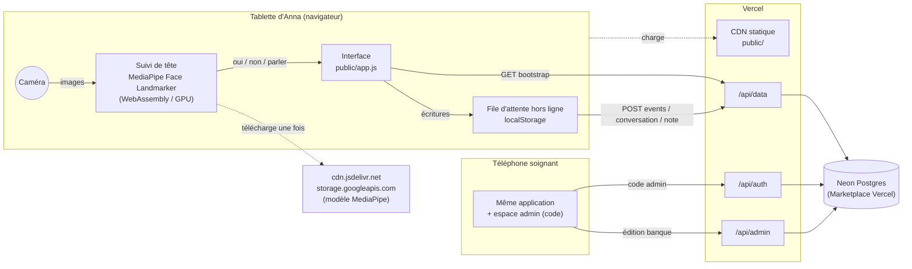
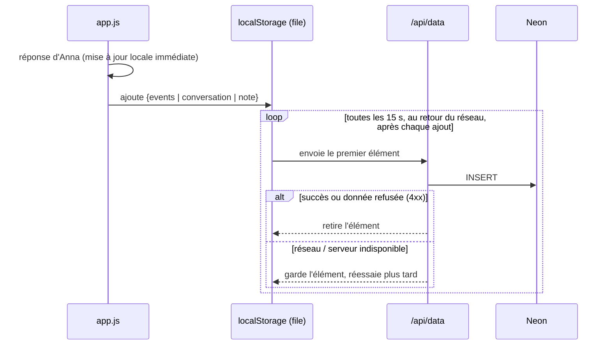
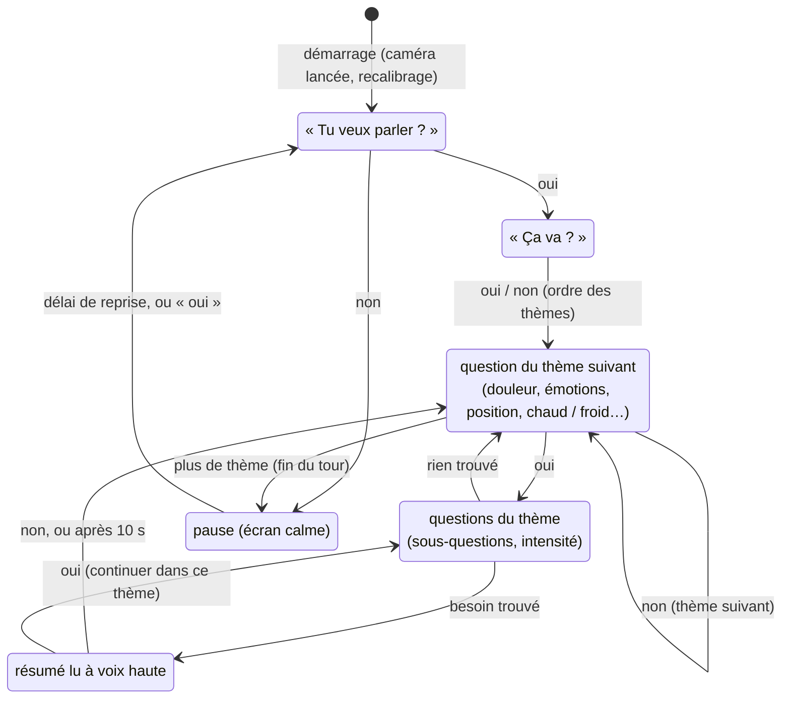
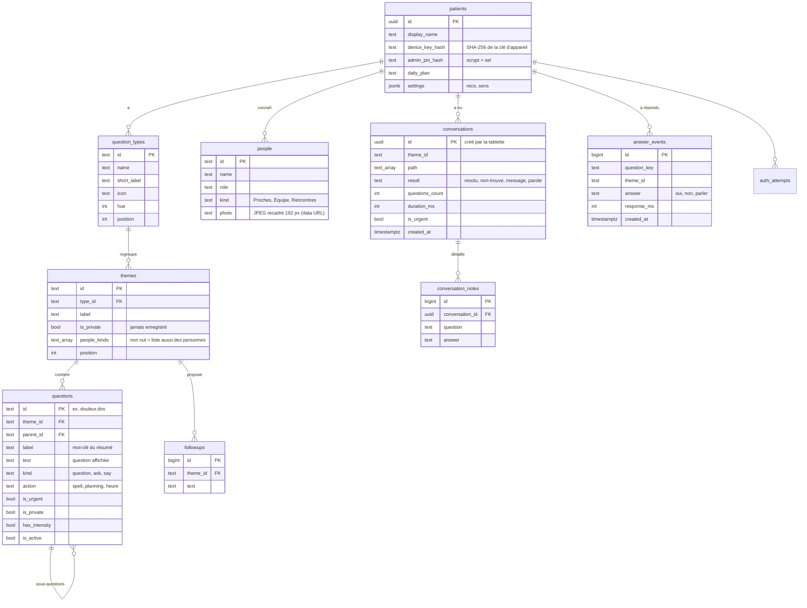
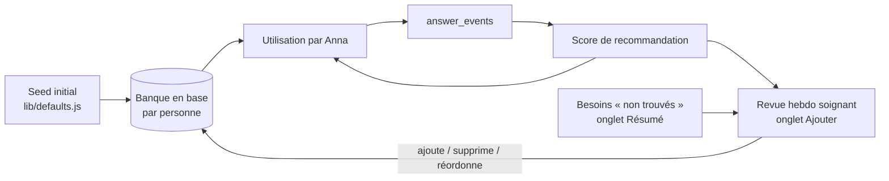

# Architecture technique — Parler avec Anna

Application de communication alternative pour une personne qui répond par **oui**, **non** ou **je veux parler**, au toucher ou par **mouvements de tête** détectés par la caméra. Hébergement Vercel, base Postgres Neon.

---

## 1. Vue d'ensemble



**Principe clé : les images de la caméra ne quittent jamais la tablette.** MediaPipe tourne dans le navigateur ; seul le geste reconnu (« oui », « non », « parler ») devient une réponse, comme un appui sur un bouton.

---

## 2. Choix techniques

| Besoin | Choix | Pourquoi |
|---|---|---|
| Hébergement | Vercel, sans framework (fichiers statiques + Vercel Functions Node 20) | Déploiement en un `git push`, HTTPS fourni (obligatoire pour la caméra), aucune étape de build à maintenir |
| Base de données | **Neon Postgres** via le Marketplace Vercel | Postgres standard (portable vers un hébergeur HDS), branchement en un clic, pilote HTTP adapté aux fonctions serverless, branches de base pour les previews |
| Reconnaissance des gestes | **MediaPipe Tasks Vision — Face Landmarker** (`@mediapipe/tasks-vision@0.10.14`) | 478 points du visage en temps réel sur tablette, GPU avec repli CPU, 100 % local |
| Front | HTML + JavaScript (modules ES), sans framework | Le prototype validé est repris tel quel ; poids minimal sur tablette ancienne |
| Hors ligne | File d'attente locale, rejouée dans l'ordre | Le wifi d'un centre de soins coupe : aucune réponse d'Anna ne doit être perdue |
| Synthèse vocale | `speechSynthesis` du navigateur (fr-FR) | Gratuit, hors ligne, rien n'est envoyé à un service tiers |

---

## 3. Application

### 3.1 Organisation du code

```
anna-vercel/
├── public/                 → servi par le CDN Vercel
│   ├── index.html          coquille + pictogrammes SVG
│   ├── styles.css          thème clair/sombre, grille mobile
│   ├── app.js              écrans, déroulé des questions, moteur de reco, espace admin, file d'attente
│   └── head-tracking.js    MediaPipe → gestes oui / non / parler
├── api/                    → 3 Vercel Functions
│   ├── data.js             lecture de la banque, enregistrement des réponses
│   ├── auth.js             code admin (création, connexion, déconnexion)
│   └── admin.js            édition (questions, thèmes, types, personnes, réglages, clé d'appareil)
├── lib/                    code partagé côté serveur
│   ├── db.js               client Neon
│   ├── auth.js             clé d'appareil, hash du code (scrypt), session signée (HMAC)
│   ├── repo.js             requêtes de lecture
│   ├── content.js          conversions lignes SQL ⇄ arbre de questions (pur, testable)
│   └── defaults.js         banque de questions initiale
├── db/schema.sql           schéma Postgres (idempotent)
├── scripts/                migrate, seed, serveur de démo sans base
└── vercel.json             en-têtes de sécurité, autorisation caméra
```

### 3.2 Écrans

| Écran | Rôle |
|---|---|
| **Ouverture « Coucou »** | Tout premier écran : « Coucou, est-ce que tu veux parler ? » Oui / Non. Non → écran calme « D’accord, pas maintenant » avec « Reprendre » (ou oui de la tête). Oui → « Ça va ? ». Réponse enregistrée |
| **Ouverture « Ça va ? »** | Deuxième écran : « Ça va ? » en deux grands boutons Oui / Non (ou gestes de tête). La réponse est enregistrée et met en tête les thèmes utiles : **ça ne va pas** → Douleur, Émotions, Position, Chaud / froid, Boire / manger, Toilette ; **ça va** → Poser une question, Dire quelque chose, Proches, Loisirs, Ma journée, Autre sujet. Le Top 3 prend alors le pictogramme principal de chacun des 3 premiers thèmes |
| **Bouton Accueil** | Dans la barre du haut, sur tous les écrans sauf le premier : revient à « Coucou, est-ce que tu veux parler ? ». « Retour » (pendant les questions) revient à la question précédente |
| **Accueil** | Pensé pour le téléphone que tient la personne en face d'Anna : texte et pictogrammes en grand, sans défilement. Une ligne par thème = le thème, ses **3 pictogrammes les plus importants** (moteur de recommandation) et « + » pour le reste. Le nombre de lignes s'adapte à l'écran ; **Page suivante / Précédente** pour les autres thèmes. Page 1 : **Top 3** puis les besoins essentiels (Boire / manger, Douleur, Position, Toilette) |
| **Voix** | « Oui » / « Non » toujours dits à voix haute (voix française choisie explicitement, débloquée au premier toucher sur iPhone) ; lecture des questions avec le bouton Voix |
| **Oui · Non · Parler** | Absents de l'accueil : la barre de réponse et les gestes de tête (caméra) ne sont actifs que pendant les questions |
| **Page d'un thème** | Tous les pictogrammes du thème en grand, en pages si besoin ; « Oui / non » parcourt le thème question par question |
| **Question** | Une question en très grand ; réponse par Oui / Non / Parler (boutons, clavier O/N/P, ou tête) |
| **Résultat** | Résumé du besoin (« Douleur › Dos › Forte »), alerte si prioritaire, questions « Pour aller plus loin » pour l'entourage |
| **Échanger** | Anna pose une question ou dit une phrase : affichée en grand et lue à voix haute |
| **Épeler** | Balayage par groupes de lettres puis lettre par lettre |
| **Espace admin** | Protégé par code. Résumé (historique) · Ajouter (ajout de questions, ajout d’un contact avec **photo** prise à l’appareil) · Réglages (programme, gestes de tête, options) |

### 3.3 Reconnaissance des mouvements de tête

Anna tourne la tête **vers sa gauche pour dire oui** et **vers sa droite pour dire non** ; pencher la tête 1 s demande la parole. La logique oui / non a d'abord été mise au point et testée en Python avec une webcam (OpenCV + MediaPipe), puis portée telle quelle dans `head-tracking.js`.

```mermaid
sequenceDiagram
  participant C as Caméra
  participant M as Face Landmarker
  participant H as head-tracking.js
  participant A as app.js
  C->>M: image vidéo (≈30/s)
  M->>H: matrice de pose de la tête (+ 478 points)
  H->>H: angle gauche/droite (lacet) et inclinaison (roulis)<br/>par rapport à la position de repos
  Note over H: 25 premières images = position de repos (calibration)
  H->>H: amplitude de 0 (< 8°) à 1 (> 20°) ; score = part des 0,6 dernières secondes<br/>passée tournée d'un côté, pondérée par l'amplitude
  alt score « oui » ≥ 60 %
    H->>A: oui
  else score « non » ≥ 60 %
    H->>A: non
  else tête penchée tenue 1 s
    H->>A: parler
  else
    H->>H: « pas de détection précise » (score affiché)
  end
  A->>A: même traitement qu'un appui sur le bouton
```

- **Gestes** : tête tournée vers **sa gauche = oui**, vers **sa droite = non**, tête penchée tenue 1 s = je veux parler. Hocher ou baisser la tête n'est pas un geste.
- **Trois états en sortie** : `oui`, `non` ou `pas de détection précise`, toujours accompagnés d'un **score** de 0 à 100 % affiché dans le panneau caméra (jauges oui / non).
- **Hystérésis** : on entre dans oui ou non à 60 % et on en sort sous 40 %, ce qui évite les clignotements autour du seuil. Le geste est émis à l'entrée dans l'état ; Anna revient au centre avant le geste suivant.
- **Caméra** : arrière par défaut (téléphone tenu par la personne en face d'Anna, écran vers le lecteur) ; caméra avant si la tablette est posée face à Anna. Réglage dans Admin → Réglages.
- **Sens gauche / droite** : calculé dans l'image brute de la caméra ; si un appareil renvoie une image miroir, l'option « Inverser gauche et droite » (Admin → Réglages) corrige, enregistrée par personne.
- **Réglages** : « temps de détection » (durée pendant laquelle la tête reste tournée, de 0,3 à 2 s, c'est la fenêtre du score), « temporisation entre deux questions » (de 0 à 5 s : après l'affichage d'une question ou d'un résumé, les gestes de la tête sont ignorés pendant ce délai, le temps de revenir au centre ; les boutons restent actifs ; une barre se vide à l'écran et le panneau caméra indique « trop tôt »), « amplitude du mouvement » (de 50 % à 160 %, multiplie les angles de 8° et 20°), « seuil de déclenchement » (score d'entrée dans oui / non, de 40 % à 90 % ; la sortie se fait 20 points plus bas), « durée de calibration » de la position de repos (0,5 à 3 s), recalibrage au début de chaque enchaînement ou bouton « Recalibrer maintenant ».
- **Deux niveaux de réglages** : les valeurs d'Anna, dans l'espace admin (code requis, enregistrées en base par personne), et les réglages de l'appareil, par le bouton « Réglages » à côté de « Caméra » (sans code, gardés dans `localStorage` sous `anna-cam`), qui les remplacent sur cet appareil seulement : la caméra, sa position et la lumière diffèrent entre le téléphone tenu par un proche et la tablette posée face à Anna. Ils s'appliquent en direct (le suivi relit les réglages à chaque image) et un bouton revient aux valeurs d'Anna.
- **Anti-rebond** : 1 s de pause après un oui/non, 2 s après « parler ».
- **Dérive lente** : la position de repos suit doucement Anna quand elle est immobile ; recalibrage manuel avec le bouton « Recalibrer » (pas de recalibrage automatique, qui prendrait une tête longuement tournée pour la position de repos).
- **Chargement** : le moteur WebAssembly et le modèle (~3,6 Mo) sont téléchargés au premier clic sur « Caméra », puis mis en cache par le navigateur.

### 3.4 Écritures et hors ligne



L'identifiant de chaque échange (UUID) est créé sur la tablette : un renvoi n'enregistre jamais de doublon (`ON CONFLICT DO NOTHING`). Le nombre d'éléments en attente s'affiche dans la barre du haut.

### 3.5 Mode automatisé (version 2)

Deux modes, réglables dans l'espace admin et enregistrés par personne (`settings.mode`) :

| Mode | Qui agit | Déroulé |
|---|---|---|
| **Classique** (défaut) | Une personne de l'entourage touche l'écran ; caméra en option | Accueil → grille des thèmes et pictogrammes → questions → résumé |
| **Automatisé** | Anna seule, par la caméra ; les boutons restent utilisables | Enchaînement ci-dessous, sans toucher l'écran |



- **Rappels** : sans réponse après le délai réglé (5 à 60 s), la question est relue ; après deux rappels, pause.
- **Reprise** : après « non, pas maintenant », la fin d'un tour ou deux rappels sans réponse, l'application redemande « Tu veux parler ? » après le délai de reprise (10 s à 5 min), ou dès un « oui » de la tête.
- **Tour** : chaque thème n'est proposé qu'une fois par tour (`auto.visited`), dans l'ordre des priorités donné par la réponse au « Ça va ? ».
- **Autres capteurs** : un geste peut aussi être injecté par l'événement DOM `anna:gesture` (détail `oui`, `non` ou `parler`), soumis à la même temporisation ; c'est le point d'entrée pour un détecteur externe.
- **Mise en œuvre** : tout est dans `public/app.js` (`isAuto()`, `autoWatch`, `autoRemind`, `autoRest`, `resumeScan`) ; les réponses passent par la même fonction `answer()` et les mêmes écritures API que le mode classique. Les réglages sont validés à un seul endroit, `normalizeSettings()` dans `lib/content.js`, utilisé par `api/admin.js`, la démo et le bootstrap ; stockés dans la colonne JSON `patients.settings`, sans migration.

---

## 4. API

Toutes les requêtes portent l'en-tête `x-device-key` (clé d'appareil). L'espace admin ajoute un cookie de session.

| Méthode | Route | Accès | Rôle |
|---|---|---|---|
| GET | `/api/data?action=bootstrap` | appareil | Banque, personnes, programme, réglages, statistiques, historique 60 jours |
| POST | `/api/data?action=events` | appareil | Réponses oui / non / parler (statistiques du moteur) |
| POST | `/api/data?action=conversation` | appareil | Un échange abouti |
| POST | `/api/data?action=note` | appareil | Réponse à une question « pour aller plus loin » |
| GET | `/api/auth?action=status` | appareil | Code existant ? Session active ? |
| POST | `/api/auth?action=setup` | appareil | Créer le code admin (si aucun) |
| POST | `/api/auth?action=login` | appareil | Ouvrir une session admin (8 h) |
| POST | `/api/auth?action=logout` | appareil | Fermer la session |
| POST | `/api/admin?action=…` | appareil + admin | `add-question`, `delete-question`, `add-theme`, `add-type`, `delete-type`, `add-followup`, `delete-followup`, `add-person`, `delete-person`, `set-person-photo`, `save-plan`, `save-settings`, `change-pin`, `rotate-device-key` |

Trois fonctions seulement (routage par `?action=`) : on reste loin des limites du plan Hobby et les démarrages à froid sont mutualisés.

---

## 5. Base de données

### 5.1 Modèle



Toutes les tables de contenu ont une clé composée `(patient_id, id)` : **plusieurs personnes accompagnées peuvent partager la même base**, chacune avec sa propre banque modifiable.

### 5.2 Règles portées par la base et l'API

- **Vie privée** : l'API refuse d'écrire tout événement ou échange d'un thème `is_private` ou d'une question `is_private` (et de ses sous-questions), même si la tablette l'envoyait par erreur.
- **Suppression d'une question** : ses sous-questions partent avec (cascade) ; les statistiques passées restent dans `answer_events`.
- **Suppression d'un type** : refusée tant qu'il contient des thèmes.
- **Identifiants de question stables** (`soif.boire.eau`) : ils relient la banque aux statistiques. Les questions générées pour chaque personne (`proches.lea.voir`) n'existent pas en base mais ont leurs statistiques.

### 5.3 Vue `question_stats`

Agrège `answer_events` sur **180 jours glissants** : nombre de fois posée, oui, non, demandes de parole, temps de réponse cumulé. C'est la seule entrée du moteur de recommandation.

---

## 6. Moteur de recommandation

```
score = 0,5 × taux de oui  +  0,3 × usage  +  0,2 × rapidité
        (oui+1)/(posée+2)     posée / max     1 − temps moyen / 8 s
```

- **Taux de oui** (lissé) : une question qui trouve souvent le besoin remonte.
- **Usage** : les questions fréquentes restent accessibles.
- **Rapidité** : une question comprise vite est une question claire.

Effets :
1. **Ordre des questions** dans chaque thème : les questions prioritaires d'abord, puis par score (désactivable dans Réglages).
2. **Accès rapide** : les 5 besoins les plus fréquents, pondérés ×2 s'ils sont habituels à cette heure (± 2 h) et atténués avec l'ancienneté (demi-vie ≈ 5 jours).
3. **Balayage « Tout parcourir »** : les thèmes les plus utilisés d'abord.

Le calcul se fait sur la tablette à partir des statistiques reçues au démarrage : l'ordre s'adapte immédiatement, même hors ligne.

---

## 7. Sécurité et confidentialité

| Sujet | Mesure |
|---|---|
| Images de la caméra | Traitées uniquement dans le navigateur, jamais envoyées ni stockées |
| Accès aux données | Clé d'appareil de 192 bits dans le lien d'installation ; seul son hash SHA-256 est en base ; la clé est retirée de l'adresse dès l'ouverture |
| Appareil perdu | « Générer un nouveau lien » révoque tous les autres appareils |
| Espace admin | Code hashé (scrypt, sel aléatoire) ; session de 8 h dans un cookie `HttpOnly; Secure; SameSite=Strict` signé HMAC-SHA256 ; 8 essais ratés max par 15 min et par adresse IP |
| Vie privée d'Anna | Thèmes et questions « sans historique » : rien n'est écrit, vérifié côté serveur |
| Injection SQL | Requêtes paramétrées uniquement (gabarits du pilote Neon) |
| En-têtes | `Permissions-Policy: camera=(self)`, HSTS, `X-Frame-Options: DENY`, `Referrer-Policy: no-referrer`, `nosniff` |
| Secrets | `DATABASE_URL` et `SESSION_SECRET` dans les variables d'environnement Vercel, jamais dans le code |

> **Données de santé (France).** Les besoins exprimés par Anna sont des données de santé. Leur hébergement pour le compte d'un établissement relève de la certification **HDS**. À notre connaissance, Vercel et Neon ne sont pas certifiés HDS : à vérifier avant tout usage réel. Cette architecture convient au hackathon et à un pilote **avec des données fictives**. Pour la production, la base (Postgres standard) et les fonctions (Node standard) se transposent chez un hébergeur certifié HDS sans réécriture.

---

## 8. Gestion

### 8.1 Rôles

| Rôle | Accès | Peut |
|---|---|---|
| **Anna** (tablette reliée) | Clé d'appareil | Répondre, épeler, demander la parole, poser des questions |
| **Entourage** (à côté d'Anna) | Même écran | Toucher un thème, poser les questions « pour aller plus loin » |
| **Soignant référent** | Clé d'appareil + code admin | Lire le résumé et l'historique, éditer la banque, les personnes, le programme, les réglages, changer le code, renouveler le lien |
| **Équipe technique** | Comptes Vercel et Neon | Déployer, migrer le schéma, créer une nouvelle personne (`db:seed`), sauvegarder et restaurer |

Évolution prévue : un compte nominatif par soignant (journal « qui a modifié quoi »), en remplacement du code partagé.

### 8.2 Cycle de vie de la banque de questions



Rituel conseillé : chaque semaine, le soignant référent regarde les besoins **non trouvés** (questions manquantes) et les questions au **score faible** (à reformuler ou supprimer).

### 8.3 Environnements et déploiement

| Environnement | Déclencheur | Base |
|---|---|---|
| Local | `npm run dev:mock` (sans base) ou `vercel dev` | aucune, ou branche Neon de dev |
| Preview | chaque pull request | branche Neon dédiée (option « Preview branching » de l'intégration Neon) |
| Production | fusion sur `main` | base Neon principale |

Migrations : `db/schema.sql` est idempotent ; `npm run db:migrate` avant le déploiement qui en dépend. Toute évolution de schéma passe d'abord sur une branche Neon de preview.

### 8.4 Exploitation

- **Sauvegardes** : restauration à un instant donné de Neon (fenêtre selon le plan) ; export `pg_dump` mensuel conseillé.
- **Supervision** : journaux des fonctions dans Vercel (les erreurs serveur sont journalisées) ; tableau de bord Neon pour la charge.
- **Conservation** : statistiques calculées sur 180 jours ; historique affiché sur 60 jours. À ajouter : purge automatique (Vercel Cron) des échanges au-delà de la durée décidée avec l'établissement.
- **Coût** : plans gratuits Vercel Hobby + Neon Free suffisants pour un pilote (quelques personnes, quelques milliers de réponses par mois).

---

## 9. Limites connues et suite

| Limite | Piste |
|---|---|
| Code admin partagé | Comptes nominatifs + journal des modifications |
| Pas de notification en cas de besoin prioritaire | Notification push ou SMS à l'équipe (Web Push, ou un service certifié santé) |
| Réordonner les questions à la main | Glisser-déposer dans l'onglet Ajouter |
| Modèle MediaPipe chargé depuis Google | L'héberger dans `public/models/` (fichier `.task` de ~3,6 Mo) pour ne dépendre d'aucun tiers |
| Gestes calibrés sur une seule personne | Profils de gestes (amplitude, délais) par personne, voire gestes alternatifs (clignement) |
| Hébergement non HDS | Migration vers un hébergeur certifié HDS avant usage réel |
